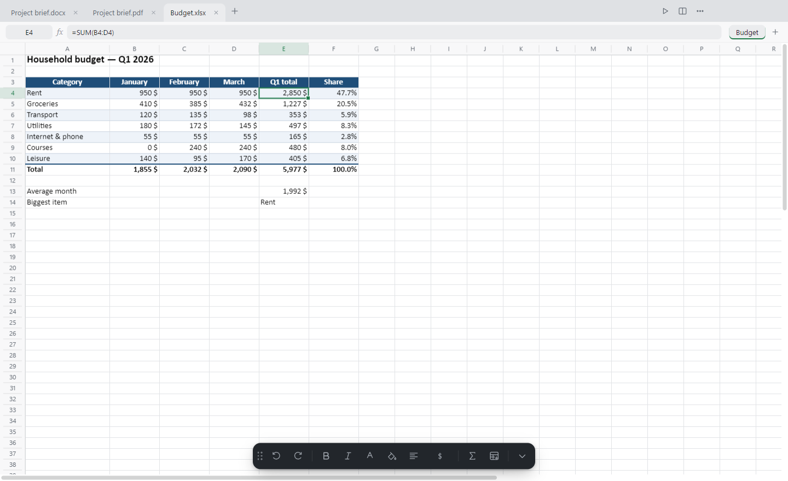
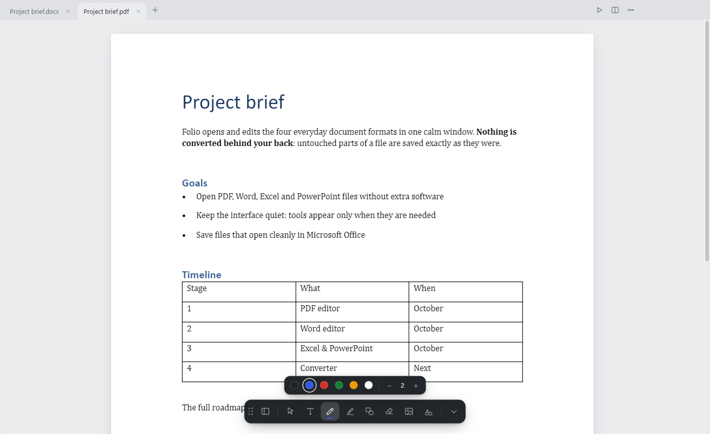
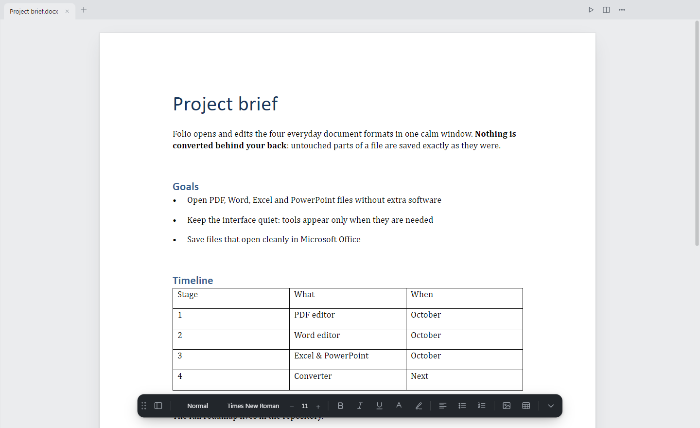
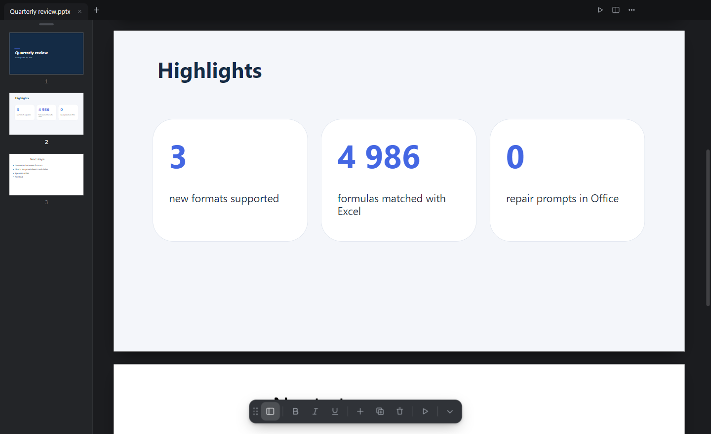

<p align="center">
  
</p>

<h1 align="center">Folio</h1>

<p align="center">
  A calm, minimal desktop editor for <b>PDF</b>, <b>Word</b>, <b>Excel</b> and <b>PowerPoint</b> files.<br>
  One window, no ribbons. Tools appear only when you need them.
</p>

<p align="center">
  <a href="https://github.com/Parzifalai/Folio/releases/latest"><b>Download for Windows</b></a> ·
  <a href="#features">Features</a> ·
  <a href="#install">Install</a> ·
  <a href="#build-from-source">Build</a>
</p>



## Why Folio

Most people open documents to read them, fix a typo, fill in a number or sign a page. Office suites are built for
much more and feel heavy for this. Folio does the everyday part well and stays out of the way:

- **One app for four formats.** PDF, `.docx`, `.xlsx` and `.pptx` open side by side in tabs, or two at once in a split view.
- **Nothing converted behind your back.** Folio edits the file itself. Paragraphs, cells and slides you did not touch
  are saved exactly as they were, so files open cleanly in Microsoft Office: no "repair" prompts.
- **Quiet interface.** A small floating toolbar you can drag to any edge or resize; hints only on hover.
- **Light and dark themes**, English, Russian and Kazakh interface.

## Features

### PDF



- Read, zoom, page thumbnails.
- Edit existing text, add text, pen, highlighter, shapes, whiteout, images and signatures.
- Select text lines and images of the PDF itself, move pages, insert blank pages, drag pages between two documents.
- Combine images into a PDF. Save as a new file.

### Word (.docx)



- Pages laid out like Word: sections, page sizes, headers and footers, tables, images, lists.
- Styles (title, headings), fonts, sizes, bold/italic/underline, colors, highlighting, alignment.
- Insert tables, images, blank pages.
- Save as `.docx` or export to PDF.

### Excel (.xlsx)

- Fast canvas grid: thousands of rows scroll smoothly. Frozen panes, merged cells, number formats, fills and borders.
- **Formulas with live recalculation.** About 80 functions, including `SUM`, `IF`, `VLOOKUP`, `INDEX/MATCH`,
  `SUMIFS`, `SUMPRODUCT`, `ROUND`, dates, text and financial functions (`NPV`, `IRR`, `PMT`). Russian function names
  (`СУММ`, `ЕСЛИ`, …) and `;` separators are understood too. Click a cell while typing a formula to insert a reference.
- Insert and delete rows and columns (formulas across all sheets follow), resize columns, fill handle, AutoSum,
  copy/paste with Excel, undo/redo, sheets (add, rename, delete).
- On real workbooks, Folio's results matched Excel on **4,986 of 4,986** formulas.
- Save as `.xlsx` or export to PDF.

### PowerPoint (.pptx)



- Slides rendered with their themes, layouts, backgrounds, shapes, images, groups and tables.
- Edit text right on the slide.
- New slides from the presentation's own layouts; duplicate, delete, hide, reorder by dragging thumbnails.
- Full-screen slideshow (F5). Save as `.pptx` or export to PDF.

## Install

1. Download the latest `Folio-*-win-x64.zip` from [Releases](https://github.com/Parzifalai/Folio/releases/latest).
2. Unzip it anywhere, for example to `D:\Folio`.
3. Run **`Установить Folio.cmd`** ("Install Folio"). It adds shortcuts to the desktop and the Start menu and adds Folio
   to *Open with* for PDF, Word, Excel and PowerPoint files. No administrator rights are needed; nothing is changed
   outside your user profile.

To remove it, run **`Удалить Folio.cmd`** ("Remove Folio") and delete the folder.

Windows may warn that the app is from an unknown publisher (the build is not code-signed). Choose *More info → Run anyway*.

## Keyboard

| | |
|---|---|
| `Ctrl+T` | New tab (start screen) |
| `Ctrl+O` / `Ctrl+S` / `Ctrl+Shift+S` | Open / save / save as |
| `Ctrl+\` | Two documents side by side |
| `Ctrl+.` | Hide or show the toolbar |
| `F5` | Slideshow (works for every format) |
| `F11` | Full screen |
| `Ctrl` + wheel, `Ctrl+0` | Zoom, fit |

## Build from source

Requirements: Windows, [Node.js](https://nodejs.org/) 18 or newer.

```bash
npm install
npm start          # run in development
npm run pack       # full build into dist/Folio-win32-x64
npm run update     # rebuild only the app bundle into dist/next (fast)
```

The project has no runtime dependencies: the app is plain HTML, CSS and JavaScript in `app/`, with the third-party
libraries vendored in `app/lib/`.

```
main.js, preload.js   Electron main process: windows, files, dialogs, PDF printing
app/app.js            Shell: tabs, split view, start screen, shortcuts
app/pdf/              PDF editor (PDF.js for rendering, pdf-lib for saving)
app/docx/             Word editor
app/xlsx/             Excel editor: formula.js (formula engine), numfmt.js (number formats), editor.js
app/pptx/             PowerPoint editor
app/i18n.js           Interface translations
tools/                Installer and build scripts
```

## Limitations

Folio is young. Known gaps, roughly in the order they are planned:

- Excel: charts, images on sheets, sorting and filters are not shown or edited yet. Formulas using named ranges and some
  rare functions are kept as they are and recalculated by Excel when the file is opened.
- PowerPoint: charts are shown as placeholders; shapes cannot be moved or resized yet; speaker notes and animations are
  preserved but not shown.
- Word: page breaks are close to Word but not identical; headers and footers are shown but not editable; no find/replace.
- PDF: no password-protected files, form filling or printing yet.

## License

[MIT](LICENSE). Bundled libraries keep their own licenses, see [THIRD_PARTY_NOTICES.md](THIRD_PARTY_NOTICES.md).
